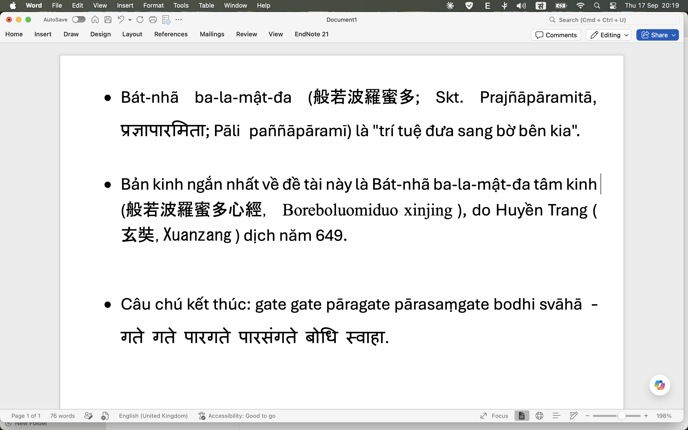
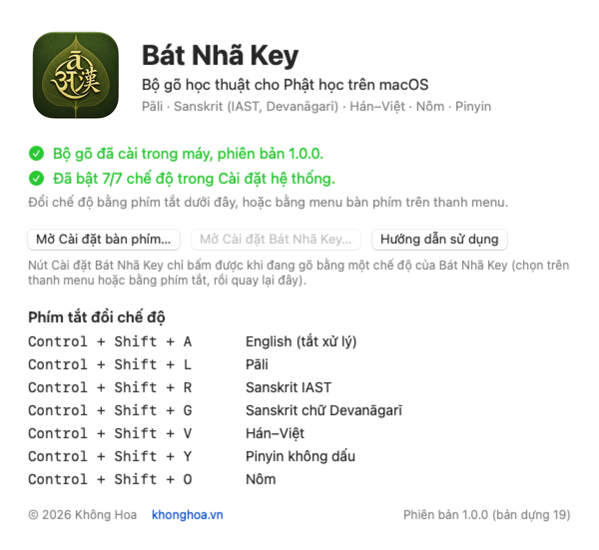
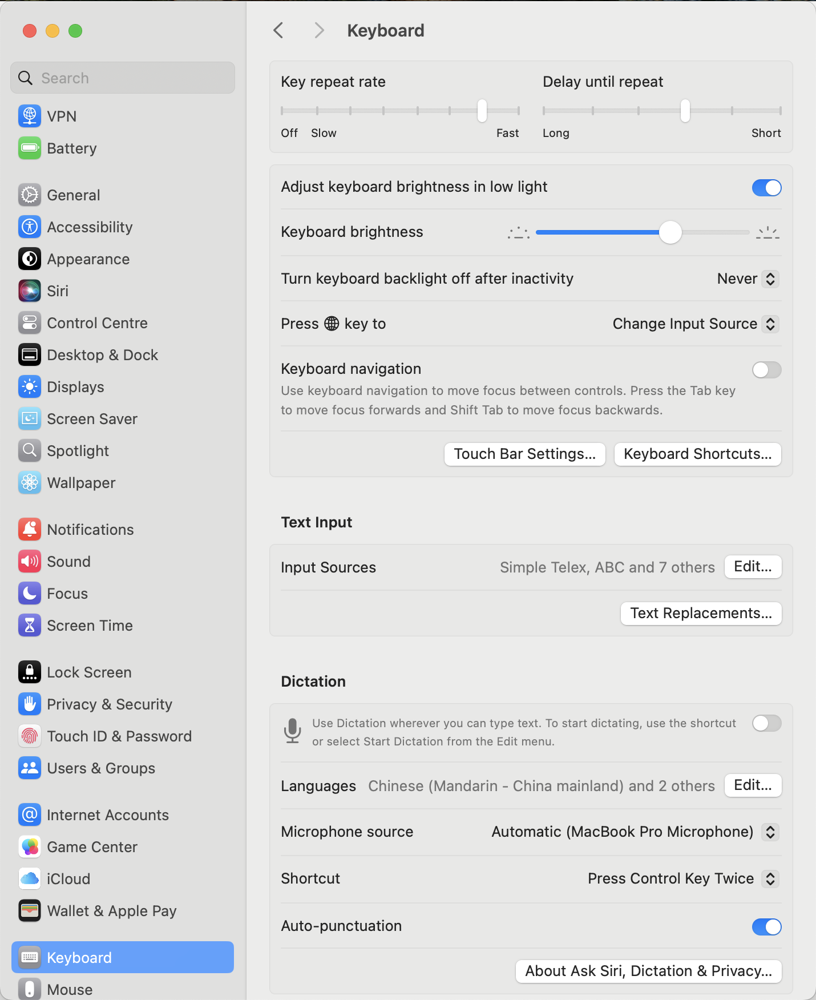
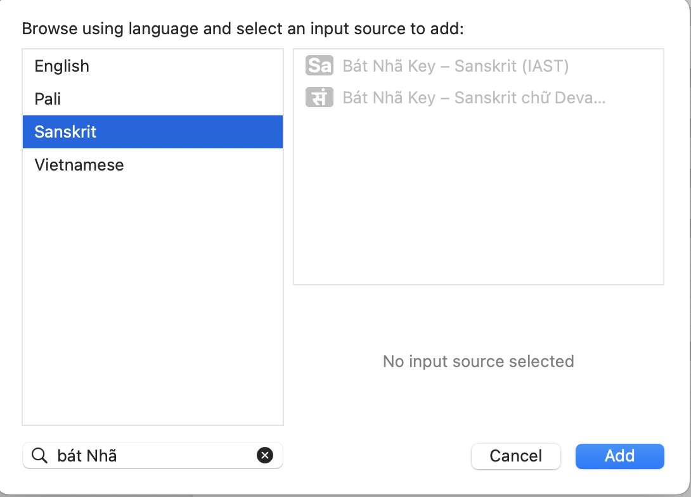
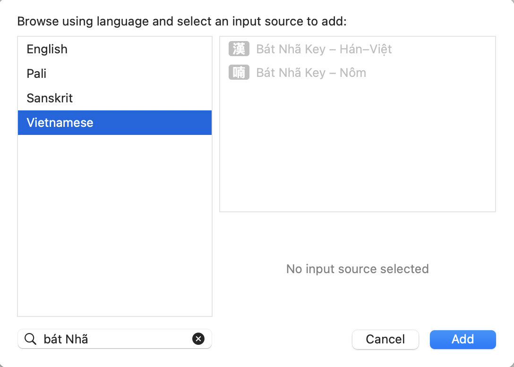
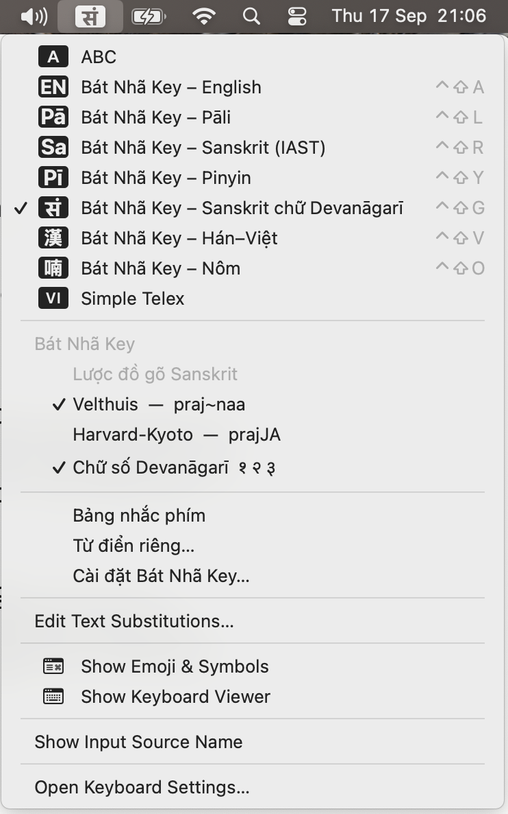
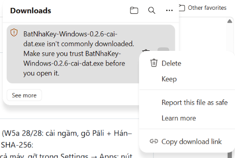
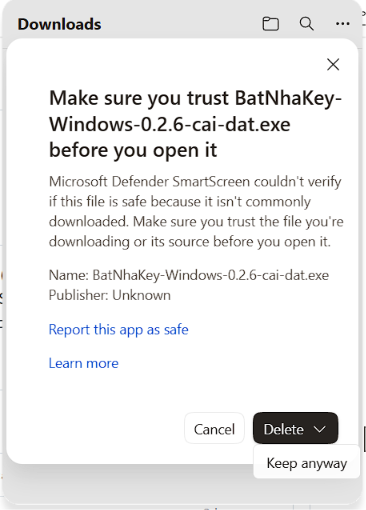

# Bát Nhã Key — Tải về và cài đặt

Bát Nhã Key là bộ gõ dành cho người học và viết về Phật học: gõ Pāli, Sanskrit (chuyển tự IAST và
chữ Devanāgarī), chữ Hán qua âm Hán–Việt, và chữ Nôm — ngay trong Word, trình duyệt, Zotero,
Obsidian hay bất kỳ ứng dụng nào. Có bản cho **[Mac](#mac)** và cho **[Windows](#windows)**.

Miễn phí vĩnh viễn. Bộ gõ chạy hoàn toàn trên máy: không kết nối mạng, không thu thập gì.

---

## Mac

### Yêu cầu

- macOS 12 (Monterey) trở lên; chạy trên cả máy Intel lẫn máy chip Apple.
- Gói cài kèm phông **Nôm Na Tống** (vào `/Library/Fonts`) để chữ Nôm hiện đủ, không ra ô vuông.

### 1. Tải về

Tải **BatNhaKey-1.3.0.pkg** (khoảng 24 MB) ở trang **[Bát Nhã Key cho Mac](https://github.com/sakyanhuanminh/bat-nha-key/releases/latest)**.

Gói được Apple ký (Developer ID) và công chứng (notarized), nên macOS mở thẳng, không cảnh báo
"nhà phát triển không xác định".

### 2. Cài đặt

1. Mở tệp `.pkg` vừa tải → **Tiếp tục** → **Cài đặt**.
2. Nhập mật khẩu máy khi được hỏi (bộ gõ được cài vào `/Library/Input Methods`, dùng được cho mọi
   tài khoản trên máy).
3. Bấm **Đóng** khi báo *Đã cài đặt thành công*.
4. **Đăng xuất rồi đăng nhập lại** (hoặc khởi động lại máy). macOS chỉ đọc danh sách bộ gõ lúc
   đăng nhập; bỏ bước này thì bước 3 dưới đây sẽ không thấy gì.

Gói cài hai thứ: **bộ gõ** (nằm trong `/Library/Input Methods`, không hiện trong Launchpad — quy định
của macOS, bộ gõ của Apple cũng vậy) và **ứng dụng Bát Nhã Key** trong Applications/Launchpad. Mở
ứng dụng ấy bất cứ lúc nào để xem bộ gõ đã sẵn sàng chưa, đã bật mấy chế độ, xem bảng phím tắt và
đi tới đúng chỗ trong Cài đặt hệ thống.

### 3. Thêm bộ gõ vào hệ thống — bước quan trọng nhất

macOS không tự bật bộ gõ mới; bạn thêm nó vào danh sách nguồn nhập **một lần**:

1. Mở **Cài đặt hệ thống** → **Bàn phím**. Ở mục **Nhập văn bản**, dòng **Nguồn đầu vào**, bấm **Sửa…**

   

2. Bấm nút **+** ở góc dưới trái, gõ **Bát Nhã** vào ô tìm kiếm. macOS gom năm chế độ theo
   **ngôn ngữ** ở cột trái — phải bấm từng ngôn ngữ và thêm:
   - **Pali** → *Bát Nhã Key – Pāli*
   - **Sanskrit** → *– Sanskrit (IAST)* và *– Sanskrit chữ Devanāgarī*
   - **Vietnamese** → *– Hán–Việt* và *– Nôm*

   Chọn (giữ ⌘ để chọn nhiều) rồi bấm **Thêm**; lặp lại cho từng ngôn ngữ.

   
   

3. Bật **Hiển thị menu Nhập liệu trong thanh menu** để đổi chế độ bằng chuột.

Chưa thấy "Bát Nhã Key" trong danh sách? Đăng xuất rồi đăng nhập lại (hoặc khởi động lại máy).

Nếu trước đây bạn đã thêm chế độ English hay Pinyin của Bát Nhã Key (bản 1.2 trở về trước): từ
1.3.0 hai chế độ ấy không còn, hai mục ấy tự biến khỏi danh sách.

### 4. Chuyển chế độ

Bấm biểu tượng bộ gõ trên thanh menu (góc trên phải) rồi chọn chế độ, hoặc giữ **Control + Shift**
rồi bấm một chữ cái:

| Phím | Chế độ | Biểu tượng |
|---|---|---|
| Control+Shift+**L** | Pāli | `Pā` |
| Control+Shift+**R** | Sanskrit IAST | `Sa` |
| Control+Shift+**G** | Sanskrit chữ Devanāgarī | `सं` |
| Control+Shift+**V** | Hán–Việt | `漢` |
| Control+Shift+**O** | Nôm | `喃` |

Muốn gõ chữ thường (tiếng Anh, tiếng Việt): chuyển sang bàn phím khác của máy bằng **Control + Space**.
Bật/tắt bảng nhắc phím: **Control + Option + K**.

### 5. Gỡ cài đặt (Mac)

Chọn một bộ gõ khác trên thanh menu → Finder → menu **Đi** → **Đi tới thư mục…** → gõ
`/Library/Input Methods` → kéo **BatNhaKey.app** vào Thùng rác (nhập mật khẩu); kéo luôn **Bát Nhã
Key** trong Applications vào Thùng rác → đăng xuất rồi đăng nhập lại. Từ điển riêng của bạn vẫn còn
trong `~/Library/Containers/vn.khonghoa.inputmethod.BatNhaKey/` — xoá thư mục ấy nếu muốn sạch hẳn.

---

## Windows

### Yêu cầu

- **Windows 10 bản 1809 trở lên, hoặc Windows 11.**
- **Máy 64-bit chip Intel hoặc AMD.** Máy chip ARM (Snapdragon…) chưa được hỗ trợ — bộ cài sẽ báo
  và dừng.
- Cần **quyền quản trị** lúc cài (cài cho cả máy). Sau khi cài, mỗi tài khoản tự bật bộ gõ cho mình,
  không cần quyền quản trị.
- Bộ cài kèm phông **Nôm Na Tống** (cài vào máy nếu máy chưa có) để chữ Nôm hiện đủ.

### Bộ cài chưa có chữ ký số — đọc trước khi cài

Bộ cài Windows **chưa được ký số**. Vì vậy Windows và trình duyệt sẽ cảnh báo — đó là cảnh báo cho
mọi tệp chưa ký và còn ít người tải, **không** phải Windows phát hiện virus. Mỗi bản phát hành có mã
kiểm tra **SHA-256** trên trang tải để bạn đối chiếu tệp.

- **Lúc tải bằng Edge**: có thể hiện *"… isn't commonly downloaded. Make sure you trust … before you
  open it"*. Trong bảng Tải xuống, bấm **…** cạnh tệp → **Keep**; hộp *Make sure you trust…* hiện ra →
  bấm mũi tên cạnh **Delete** → **Keep anyway**. (Giao diện Edge đổi theo phiên bản; tên nút có thể
  hơi khác.)

  
  

- **Lúc mở bộ cài**: có thể hiện màn hình xanh **"Windows protected your PC"**. Bấm **More info**
  (Thông tin thêm) → **Run anyway** (Vẫn chạy).

- **Máy Windows 11 bật Smart App Control**: Smart App Control **chặn hẳn** ứng dụng chưa ký, **không
  có nút "vẫn chạy"** và không cho phép riêng một ứng dụng. Xem trạng thái ở **Settings → Privacy &
  security → Windows Security → App & browser control → Smart App Control**: *On* (đang chặn),
  *Evaluation* (đang đánh giá), *Off* (tắt). Nếu là **On**, bạn sẽ không cài được Bát Nhã Key cho
  Windows. Tắt Smart App Control là quyết định của riêng bạn: nó là một lớp bảo vệ của Windows, và
  trên nhiều bản Windows, **đã tắt thì muốn bật lại phải cài lại Windows** (các bản cập nhật gần đây
  có cho bật lại, nhưng Microsoft chưa ghi rõ từ bản nào). Chúng tôi không khuyên tắt. Windows 10
  không có Smart App Control.

### 1. Tải về

Tải **BatNhaKey-Windows-1.0.0-cai-dat.exe** (khoảng 31 MB) ở trang
**[Bát Nhã Key cho Windows 1.0.0](https://github.com/sakyanhuanminh/bat-nha-key/releases/tag/win-v1.0.0)**.

### 2. Cài đặt

1. Mở tệp vừa tải (xem phần cảnh báo ở trên nếu Windows hỏi).
2. Windows hỏi quyền quản trị (*Do you want to allow this app…*, nhà phát hành *Unknown*) → **Yes**.
3. Bộ cài bằng tiếng Việt: **Tiếp >** → **Cài đặt** → **Xong**.
4. **Khởi động lại máy** để mọi ứng dụng đang mở dùng được bộ gõ.

Bộ cài thêm *Bát Nhã Key* vào danh sách bàn phím của tài khoản đang cài, và thêm **Cài đặt Bát Nhã
Key** vào menu Start. Tài khoản khác trên cùng máy: mở **Cài đặt Bát Nhã Key** từ menu Start, chọn
**Có** khi được hỏi bật (hoặc thẻ *Giới thiệu* → **Bật Bát Nhã Key cho tài khoản này**).

### 3. Gõ và đổi chế độ

1. Bấm **Windows + Space** (hoặc bấm chữ **VIE**/**ENG** ở góc phải thanh tác vụ) → chọn **Bát Nhã Key**.
2. Đổi chế độ: bấm **biểu tượng cạnh chữ VIE** rồi chọn, hoặc bấm **Ctrl + Alt + B** để xoay vòng
   Pāli → Sanskrit IAST → Devanāgarī → Hán–Việt → Nôm. Ctrl + Alt + B chỉ có tác dụng khi đang ở Bát
   Nhã Key; muốn gõ chữ thường thì Windows + Space sang bàn phím khác.
3. Thử: mở Notepad, ở chế độ Pāli gõ `Buddha.m` rồi phím cách → *Buddhaṃ*; ở Hán–Việt gõ `bat nha`
   rồi `1` → *般若*.

### 4. Cửa sổ Cài đặt Bát Nhã Key

Menu Start → **Cài đặt Bát Nhã Key** (hoặc menu ở biểu tượng cạnh chữ VIE). Bốn thẻ: **Gõ chữ**
(niggahīta ṃ/ṁ, lược đồ Velthuis/Harvard-Kyoto, chữ số Devanāgarī, phồn/giản thể, ưu tiên Phật học,
phím cách chọn chữ, Nôm kèm chữ Hán, bảng nhắc phím), **Ghi nhớ chữ**, **Từ điển riêng** (sửa được
bằng Excel; sao lưu, khôi phục — nhận cả thư mục sao lưu của bản Mac), **Giới thiệu** (phiên bản,
nguồn dữ liệu, ô *Tự kiểm bản mới*).

### 5. Gỡ cài đặt (Windows)

**Settings → Apps → Installed apps → Bát Nhã Key → … → Uninstall.** Bộ gỡ hỏi có xoá luôn dữ liệu
của bạn (từ điển riêng, chữ đã nhớ, tuỳ chọn gõ) không — mặc định **Không**, để cài lại thì dùng
tiếp. Phông Nôm Na Tống chỉ bị gỡ nếu chính bộ cài đã cài nó. Tệp còn bị ứng dụng đang mở giữ sẽ được
xoá khi khởi động lại máy. Tài khoản khác trên máy: Bát Nhã Key tự rời danh sách bàn phím của họ ở lần
đăng nhập sau.

---

## Nếu bạn đang dùng bộ gõ tiếng Việt (Unikey, EVKey, OpenKey…)

Các phần mềm ấy chạy chồng lên mọi bộ gõ. Khi dùng Bát Nhã Key, hãy chuyển chúng sang **E** (tắt gõ
tiếng Việt); Bát Nhã Key cũng sẽ nhắc nếu phát hiện xung đột. Viết tiếng Việt thì chuyển sang bàn
phím khác của máy rồi bật lại các phần mềm ấy.

## Hỗ trợ

Câu hỏi, góp ý, đính chính: hukhonghoa@gmail.com. Cách gõ từng chế độ: xem
[Hướng dẫn sử dụng](SU-DUNG.md).

---

## In English — quick install

**Bát Nhã Key** is a free input method for Buddhist studies: Pāli, Sanskrit (IAST and Devanāgarī),
Chinese characters via Sino-Vietnamese readings, and Nôm. The input method itself is fully offline.

**Mac** (macOS 12+, Intel or Apple silicon): download **BatNhaKey-1.3.0.pkg** from the
[Mac release](https://github.com/sakyanhuanminh/bat-nha-key/releases/latest) and open it; log out and
back in; then **System Settings → Keyboard → Text Input → Input Sources → Edit… → +**, search
**Bát Nhã**, add the modes. Switch with **Control+Shift** + L (Pāli) · R (IAST) · G (Devanāgarī) ·
V (Hán–Việt) · O (Nôm).

**Windows** (Windows 10 1809+ / 11, x64 only): download **BatNhaKey-Windows-1.0.0-cai-dat.exe** from
the [Windows release](https://github.com/sakyanhuanminh/bat-nha-key/releases/tag/win-v1.0.0). The
installer is **not code-signed**: Edge may say it "isn't commonly downloaded" (… → Keep → Keep
anyway) and Windows may show "Windows protected your PC" (More info → Run anyway). **PCs with Smart
App Control turned On will block it** with no override. Pick Bát Nhã Key with **Windows + Space**;
**Ctrl + Alt + B** cycles the five modes. Uninstall from Settings → Apps.

---

© 2026 Không Hoa — [khonghoa.vn](https://khonghoa.vn). Bảo lưu mọi quyền. Bát Nhã Key miễn phí vĩnh viễn cho học tập và nghiên cứu; mã nguồn là tài sản của tác giả. Dữ liệu từ điển mang giấy phép của từng nguồn mở ([NGUON-DU-LIEU.md](NGUON-DU-LIEU.md)).
