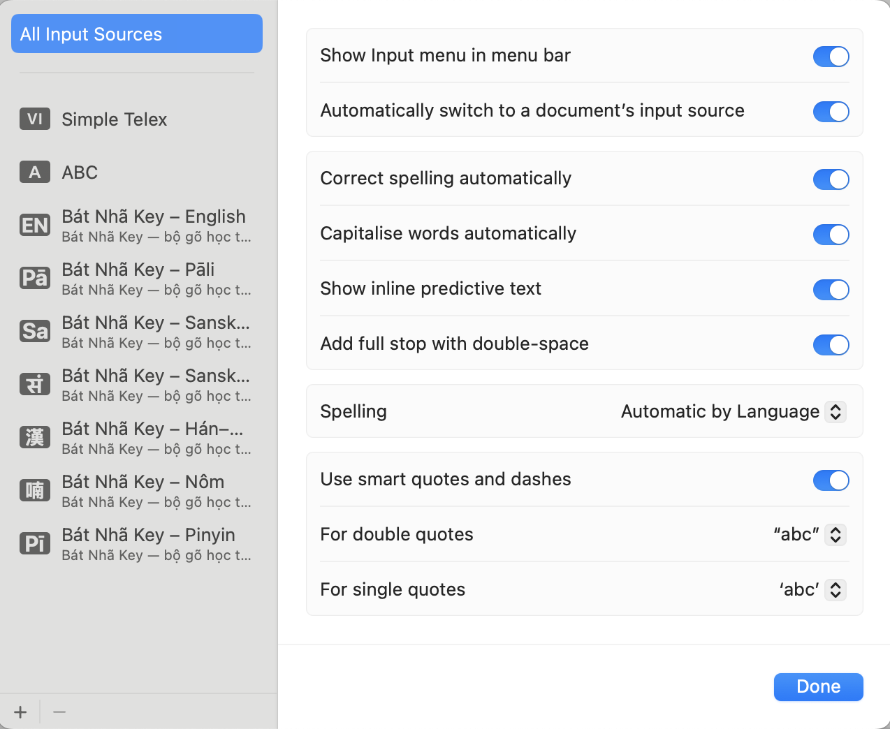

# Bát Nhã Key — Tải về và cài đặt

Bát Nhã Key là bộ gõ cho macOS, dành cho người học và viết về Phật học: gõ Pāli, Sanskrit
(chuyển tự IAST và chữ Devanāgarī), chữ Hán qua âm Hán–Việt, chữ Nôm, và pinyin không dấu —
ngay trong Word, Pages, Safari, Zotero, Obsidian, Mail hay bất kỳ ứng dụng nào.

Miễn phí. Chạy hoàn toàn trên máy: không kết nối mạng, không thu thập gì.

## Yêu cầu

- macOS 12 (Monterey) trở lên; chạy trên cả máy Intel lẫn Apple Silicon.
- Không cần cài thêm font: macOS có sẵn font cho Devanāgarī, chữ Hán và chữ Nôm.

## 1. Tải về

Tải gói cài đặt **BatNhaKey-1.0.0.pkg** (khoảng 9 MB): https://github.com/sakyanhuanminh/bat-nha-key/releases/latest

Gói được ký bằng chứng chỉ Developer ID và đã được Apple công chứng (notarized), nên macOS
mở thẳng, không cảnh báo "nhà phát triển không xác định".

## 2. Cài đặt

1. Mở file `.pkg` vừa tải → **Tiếp tục** → **Cài đặt**.
2. Nhập mật khẩu máy khi được hỏi (bộ gõ được cài vào `/Library/Input Methods`, dùng được cho mọi
   tài khoản trên máy).
3. Bấm **Đóng** khi báo *Đã cài đặt thành công*.
4. **Đăng xuất rồi đăng nhập lại.** macOS chỉ đọc danh sách bộ gõ lúc đăng nhập; bỏ bước này thì
   bước 3 dưới đây sẽ không thấy gì.

Gói cài hai thứ: **bộ gõ** (nằm trong `/Library/Input Methods`, không hiện trong Launchpad — quy định
của macOS, bộ gõ của Apple cũng vậy) và **ứng dụng Bát Nhã Key** trong Applications/Launchpad. Mở
ứng dụng ấy bất cứ lúc nào để xem bộ gõ đã sẵn sàng chưa, đã bật mấy chế độ, và đi tới đúng chỗ.

## 3. Thêm bộ gõ vào hệ thống — bước quan trọng nhất

macOS không tự bật bộ gõ mới; bạn thêm nó vào danh sách nguồn nhập **một lần**:

1. Mở **Cài đặt hệ thống** →  **Bàn phím**. Ở mục **Nhập văn bản**, dòng **Nguồn đầu vào**, bấm **Sửa…**

   

2. Bấm nút **+** ở góc dưới trái, gõ **Bát Nhã** vào ô tìm kiếm. macOS gom bảy chế độ theo
   **ngôn ngữ** ở cột trái — phải bấm từng ngôn ngữ và thêm:
   - **English** → *Bát Nhã Key – English* và *– Pinyin*
   - **Pali** → *– Pāli*
   - **Sanskrit** → *– Sanskrit (IAST)* và *– Sanskrit chữ Devanāgarī*
   - **Vietnamese** → *– Hán–Việt* và *– Nôm*

   Chọn (giữ ⌘ để chọn nhiều) rồi bấm **Thêm**; lặp lại cho từng ngôn ngữ.

   
   

3. Bật **Hiển thị menu Nhập liệu trong thanh menu** để đổi chế độ bằng chuột.

   

Chưa thấy "Bát Nhã Key" trong danh sách? Đăng xuất rồi đăng nhập lại (hoặc khởi động lại máy) —
macOS chỉ đọc danh sách bộ gõ lúc đăng nhập.

## 4. Chuyển chế độ

Bấm biểu tượng bộ gõ trên thanh menu (góc trên phải) rồi chọn chế độ, hoặc dùng phím tắt —
giữ **Control + Shift** rồi bấm một chữ cái:

| Phím | Chế độ | Biểu tượng |
|---|---|---|
| Control+Shift+**A** | English (gõ thẳng, không xử lý) | `EN` |
| Control+Shift+**L** | Pāli | `Pā` |
| Control+Shift+**R** | Sanskrit IAST | `Sa` |
| Control+Shift+**G** | Sanskrit chữ Devanāgarī | `सं` |
| Control+Shift+**V** | Hán–Việt | `漢` |
| Control+Shift+**Y** | Pinyin (Hán–Việt → pinyin không dấu) | `Pī` |
| Control+Shift+**O** | Nôm | `喃` |

## 5. Nếu bạn đang dùng bộ gõ tiếng Việt (EVKey, OpenKey, GõTiếngViệt…)

Các phần mềm ấy chạy chồng lên mọi bộ gõ. Khi dùng Bát Nhã Key, hãy chuyển chúng sang **E**
(tắt gõ tiếng Việt); Bát Nhã Key cũng sẽ nhắc bạn nếu phát hiện xung đột.
Chuyển sang chế độ **English** của Bát Nhã Key (hoặc bộ gõ ABC của macOS) khi viết tiếng Việt.

## 6. Gỡ cài đặt

Cách nhanh: mở file **Go-cai-dat-BatNhaKey.command** tải kèm gói (nhập mật khẩu máy).

Cách tay: chọn một bộ gõ khác trên thanh menu → Finder → menu **Đi** → **Đi tới thư mục…** →
gõ `/Library/Input Methods` → kéo **BatNhaKey.app** vào Thùng rác (nhập mật khẩu); kéo luôn
**Bát Nhã Key** trong Applications vào Thùng rác → đăng xuất rồi đăng nhập lại. Từ điển riêng của bạn vẫn còn trong
`~/Library/Containers/vn.khonghoa.inputmethod.BatNhaKey/` — xoá thư mục ấy nếu muốn sạch hẳn.

## Hỗ trợ

Câu hỏi, góp ý, đính chính: hukhonghoa@gmail.com. Hướng dẫn sử dụng từng chế độ: xem bài
[Hướng dẫn sử dụng Bát Nhã Key](huong-dan-su-dung.md).

---

## In English — quick install

**Bát Nhã Key** is a free macOS input method for Buddhist studies: Pāli, Sanskrit (IAST and
Devanāgarī), Chinese characters via Sino-Vietnamese readings, Nôm, and toneless pinyin.
Requires macOS 12+, Intel or Apple Silicon. Fully offline.

1. Download **BatNhaKey-1.0.0.pkg** (https://github.com/sakyanhuanminh/bat-nha-key/releases/latest) and open it. Enter your Mac password; the
   input method is installed in `/Library/Input Methods` for all users, plus a small **Bát Nhã Key**
   app in Applications/Launchpad that shows whether the input method is ready. Log out and back in.
2. **System Settings → Keyboard → Text Input → Input Sources → Edit… → +**, search for
   **Bát Nhã**, select the modes you want, click **Add**. Turn on *Show Input menu in menu bar*.
   If nothing appears, log out and back in.
3. Switch modes from the input menu or with **Control+Shift** + A (English) · L (Pāli) ·
   R (Sanskrit IAST) · G (Devanāgarī) · V (Hán–Việt) · Y (Pinyin) · O (Nôm).
4. Type: Pāli/IAST use the Velthuis scheme (`aa` → ā, `.t` → ṭ, `~n` → ñ; Harvard-Kyoto is an
   option); Hán–Việt: type the Sino-Vietnamese reading (`bo tat`) and pick 菩薩 from the popup;
   Pinyin mode: type `huyen trang`, press 1 → `xuanzang` (hold Shift → `Xuanzang`).
5. Uninstall: open the bundled *Go-cai-dat-BatNhaKey.command*, or drag `BatNhaKey.app` out of
   `/Library/Input Methods` and out of `/Applications`, then log out.

---

© 2026 Không Hoa — [khonghoa.vn](https://khonghoa.vn). Bảo lưu mọi quyền. Bát Nhã Key miễn phí cho học tập và nghiên cứu; mã nguồn là tài sản của tác giả. Dữ liệu từ điển mang giấy phép của từng nguồn mở (Cài đặt → Nguồn dữ liệu).
