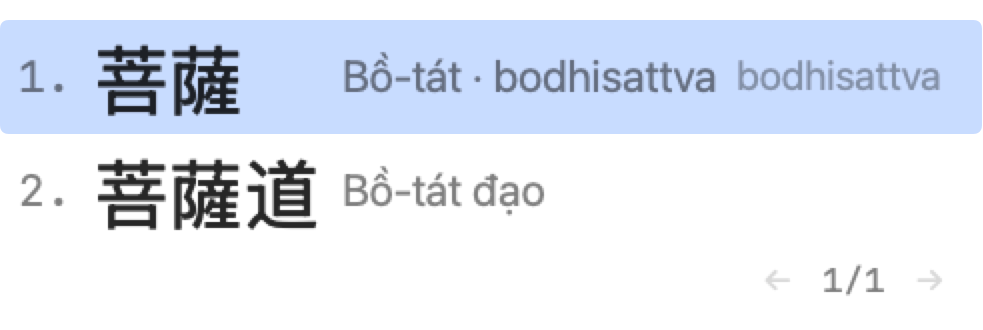
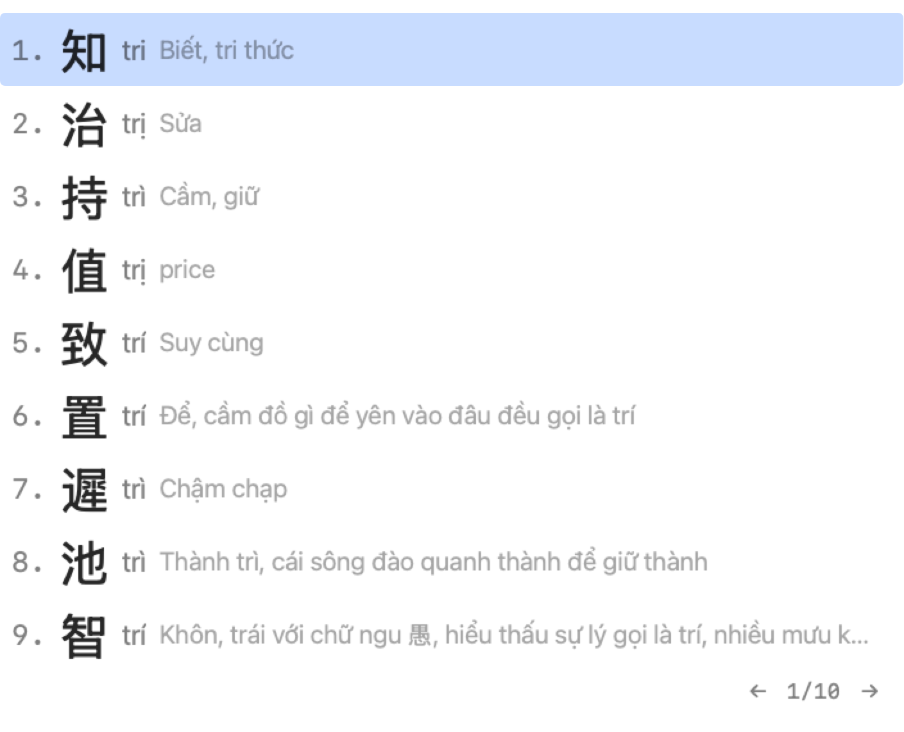
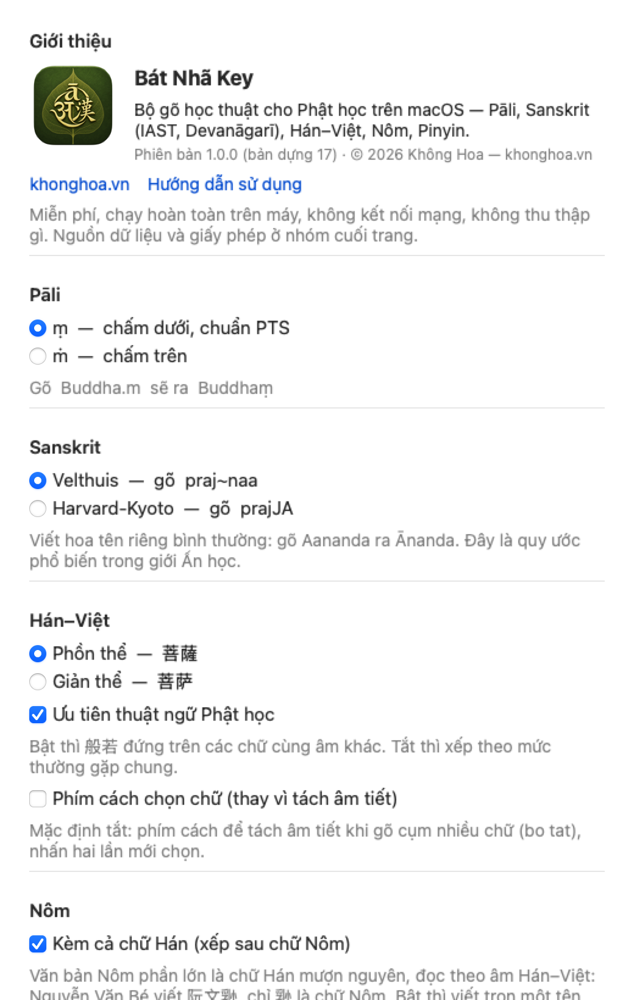

# Hướng dẫn sử dụng Bát Nhã Key

Bài này đi qua từng chế độ với ví dụ gõ thật. Nếu chưa cài, xem [Tải về và cài đặt](cai-dat.md).

Quy ước chung cho cả bài: `chữ trong khung` là **phím bạn gõ**, chữ nghiêng là *kết quả*.

## Bảy chế độ, một bộ gõ

| Chế độ | Bạn gõ | Ra | Dùng khi |
|---|---|---|---|
| English | như bàn phím thường | y nguyên | viết tiếng Anh/Việt, không cần dấu đặc biệt |
| Pāli | `pa~n~naa` | *paññā* | văn bản Pāli mẫu tự Latin |
| Sanskrit IAST | `praj~naa` | *prajñā* | Sanskrit chuyển tự học thuật |
| Sanskrit Devanāgarī | `prajJA` | *प्रज्ञा* | Sanskrit nguyên tự |
| Hán–Việt | `bo tat` → chọn | *菩薩* | chữ Hán, thuật ngữ Phật học |
| Nôm | `nguoi` → chọn | *𠊛* | chữ Nôm, tên Việt |
| Pinyin | `huyen trang` → chọn | *xuanzang* | bài tiếng Anh cần pinyin không dấu |

Đổi chế độ: menu bộ gõ trên thanh menu, hoặc **Control+Shift** + chữ cái (A L R G V Y O — xem
bài cài đặt). Chế độ hiện tại luôn hiện bằng biểu tượng nhỏ trên thanh menu.

## Pāli và Sanskrit IAST — gõ theo lối Velthuis

Nguyên tắc: **gõ đôi để kéo dài, chấm để đặt dấu dưới, ngã để đặt dấu trên.**

| Muốn | Gõ | Muốn | Gõ |
|---|---|---|---|
| ā ī ū | `aa` `ii` `uu` | ṭ ḍ ṇ ḷ | `.t` `.d` `.n` `.l` |
| ṃ (niggahīta) | `.m` | ñ | `~n` |
| ṅ | `"n` | ś ṣ | `"s` `.s` |
| ṛ ṝ ḷ | `.r` `.rr` `.l` | ḥ | `.h` |

Ví dụ: `dhammo` → *dhammo* (không đổi gì); `sa.msaaro` → *saṃsāro*; `"suunyataa` → *śūnyatā*;
`k.r.s.na` → *kṛṣṇa*.

- Chữ hiện ngay dưới con trỏ (có gạch chân) khi bạn gõ; bấm **phím cách** hay dấu câu là chữ
  vào văn bản.
- Muốn gõ **đúng nguyên văn** một từ Latin (ví dụ tên file, chữ Anh có `.t`): gõ `\` trước ký tự
  để giữ nguyên nó, hoặc bấm **Esc** để chèn nguyên văn cả chữ đang gõ dở.
- Sanskrit IAST còn lối **Harvard-Kyoto** (`prajJA` → *prajñā*, chữ HOA là ký hiệu): chọn trong
  menu bộ gõ → *Lược đồ gõ Sanskrit*.
- Bật **Bảng nhắc phím** (menu bộ gõ) để có bảng quy tắc nổi ở đáy màn hình khi mới làm quen:

  

## Sanskrit Devanāgarī

Gõ y như IAST (Velthuis hoặc Harvard-Kyoto tuỳ cài đặt), kết quả là chữ Devanāgarī:
`namo buddhaaya` → *नमो बुद्धाय*; `prajJApAramitA` (HK) → *प्रज्ञापारमिता*.

- `'` ra avagraha ऽ; `|` ra daṇḍa ।; `_` để tách hai phụ âm không cho ghép (`k_ha` ra क्ह, khác
  `kha` ra ख).
- Chữ số: mặc định giữ số Ả Rập; muốn `१ २ ३` thì bật *Chữ số Devanāgarī* trong menu bộ gõ.

  

## Hán–Việt — gõ âm, chọn chữ

Gõ âm Hán–Việt **không cần dấu** rồi chọn chữ trong cửa sổ hiện cạnh con trỏ:

- `bo tat` → cửa sổ hiện *菩薩* ở dòng 1 → bấm **1** (hoặc Enter, hoặc **bấm chuột** vào dòng).
- Gõ **thiếu dấu thì danh sách rộng**, gõ **đủ dấu thì hẹp lại**: `phat` ra mọi chữ đọc
  phát/phật/phạt…; `phatj` (Telex: `j` = nặng) chỉ còn *佛 phật*. Dấu gõ theo Telex: `s` sắc,
  `f` huyền, `r` hỏi, `x` ngã, `j` nặng; `aa` â, `ee` ê, `oo` ô, `w` ơ/ư/ă, `dd` đ.
- **Thứ tự dấu tự do**: `nguoiwf`, `nguowif`, `nguoifw` đều ra *người*; `phatja` ra *phật*;
  `dend` ra *đen* (chữ `d` cuối biến `d` đầu thành đ).
- Cụm nhiều âm: `bat nha ba la mat da` → *般若波羅蜜多*. Cụm chưa có trong từ điển thì máy **ghép**
  từ các mảnh có thật và ghi "máy ghép" ở cột nghĩa — hãy kiểm lại.
- Mỗi dòng có **âm đọc** và **nghĩa** (Thiều Chửu) để phân biệt chữ đồng âm. Thuật ngữ Phật
  học được ưu tiên lên trên (tắt được trong Cài đặt).
- Trang tiếp: `→` hoặc `PageDown`; số bấm chỉ áp cho trang đang hiện.
- **Shift+Enter** chèn nguyên chữ Latin đã gõ; **Esc** huỷ.
- Phồn thể (mặc định) hay giản thể: menu bộ gõ → *Chữ Hán*.

## Nôm

Như Hán–Việt nhưng tra kho **chữ Nôm** trước (6.105 chữ, từ Unihan), chữ Hán cùng âm hiện sau:
`nguoi` → *𠊛*; `vu` → *乳*; `be` → *㤳*. Tắt phần chữ Hán trong menu bộ gõ nếu chỉ muốn Nôm.
Tên riêng tiếng Việt, câu Nôm cổ: gõ ở đây.

## Pinyin — cho bài viết tiếng Anh

Giới Phật học quốc tế viết thuật ngữ Hán bằng **pinyin không dấu thanh**: Xuanzang, Huayan,
Tiantai. Chế độ này để bạn gõ theo âm Hán–Việt mình quen mà ra đúng dạng ấy:

- `huyen trang` → cửa sổ hiện *玄奘 · Huyền Trang · xuanzang* → bấm **1** → chèn *xuanzang*.
- Giữ **Shift** khi bấm số hoặc Enter → viết hoa chữ đầu: *Xuanzang*.
- Cùng một âm Việt có nhiều pinyin (huyền → xuan / xian / huan; trang → zang / zhuang…), nên hãy
  nhìn **chữ Hán** để chọn — cột pinyin đổi theo từng chữ.
- Từ điển đã xử lý những chữ đọc đặc biệt trong Phật học: 般若 *bore*, 南無 *namo*, 阿彌陀佛
  *amituofo*, 大乘 *dasheng*, 迦葉 *jiashe*.
- Đang ở chế độ này mà gõ một từ tiếng Anh (như `the`) thì cửa sổ vẫn hiện ứng viên: bấm **Esc**
  để chèn đúng chữ đã gõ, hoặc chuyển về English (Control+Shift+A) khi viết tiếng Anh dài.

## Từ điển riêng và chữ tắt

Menu bộ gõ → **Từ điển riêng…** (hoặc Cài đặt → nút cùng tên). Mỗi chế độ một danh sách; Pinyin
dùng chung với Hán–Việt.

- **Thêm chữ còn thiếu**: chữ *妙法蓮華經*, âm *Diệu pháp liên hoa kinh* → gõ âm là ra, và mục của bạn
  luôn đứng **trên** mục cùng âm của từ điển gốc.
- **Chữ tắt**: đặt *dplhk* cho cụm ấy → gõ `dplhk` là hiện ngay dòng 1 (Hán–Việt/Nôm/Pinyin);
  ở Pāli/Sanskrit/Devanāgarī, chữ tắt nở ra khi bấm **phím cách** (ví dụ `pn` + cách → *paññā*).
- Sửa bằng Numbers/Excel cũng được: nút **Mở thư mục** → file `user-hanviet.tsv`… (tab, có tiêu
  đề; lưu lại là bộ gõ tự nạp trong một giây).
- **Sao lưu ▾** → chép cả bộ ra Desktop; đổi máy thì **Khôi phục**.
- ⌘C chép chữ của mục đang chọn; ⌘V mở "Thêm" với chữ vừa dán; chuột phải để sao chép/sửa/xoá.

## Cài đặt

Menu bộ gõ → **Cài đặt Bát Nhã Key…**: niggahīta `ṃ`/`ṁ` cho Pāli; lược đồ Velthuis/Harvard-Kyoto;
chữ số Devanāgarī; phồn/giản thể; ưu tiên Phật học; phím cách chọn chữ hay tách âm tiết; Nôm có
kèm chữ Hán không; bảng nhắc phím; nguồn dữ liệu và giấy phép; phiên bản.

## Vài mẹo

- Bộ gõ xử lý dưới 5 phần nghìn giây mỗi phím; nếu thấy chậm, thường là ứng dụng đang gõ chậm.
- Word, Zotero, Chrome, Obsidian, Pages, Mail đều đã thử. Gặp chỗ lạ (chữ nhân đôi, cửa sổ sai
  chỗ), gửi ảnh về hukhonghoa@gmail.com kèm tên ứng dụng và chế độ đang dùng.
- Muốn quay về gõ tiếng Việt: chọn bộ gõ tiếng Việt quen dùng (ABC, EVKey…) trên thanh menu — Bát Nhã
  Key không can thiệp khi không được chọn.

---

© 2026 Không Hoa — [khonghoa.vn](https://khonghoa.vn). Bảo lưu mọi quyền. Bát Nhã Key miễn phí cho học tập và nghiên cứu; mã nguồn là tài sản của tác giả. Dữ liệu từ điển mang giấy phép của từng nguồn mở (Cài đặt → Nguồn dữ liệu).
